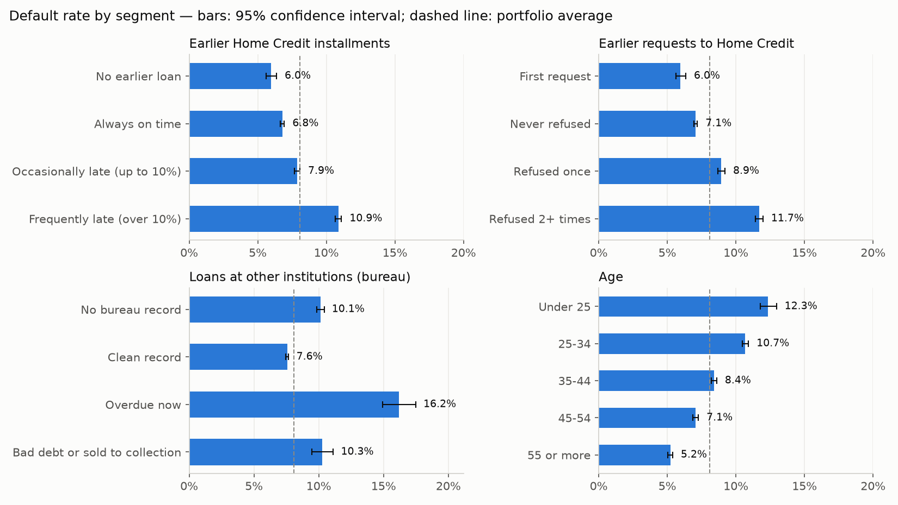
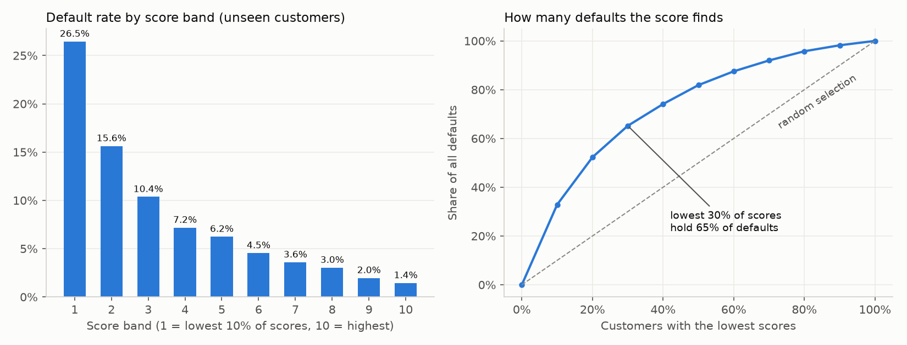
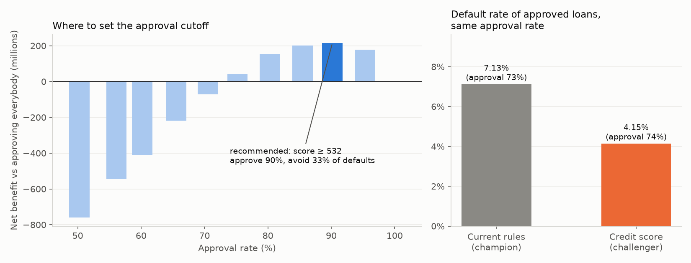
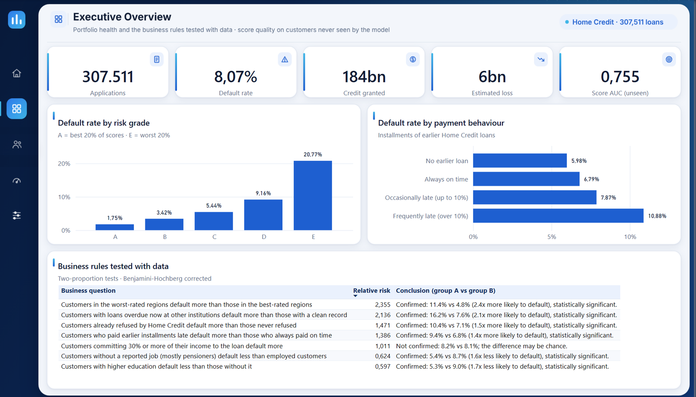
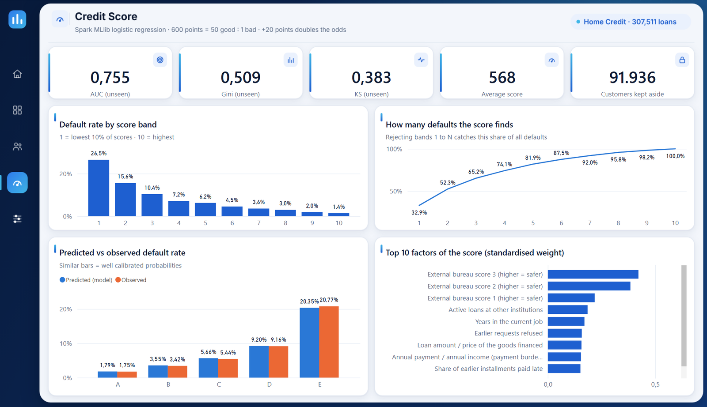
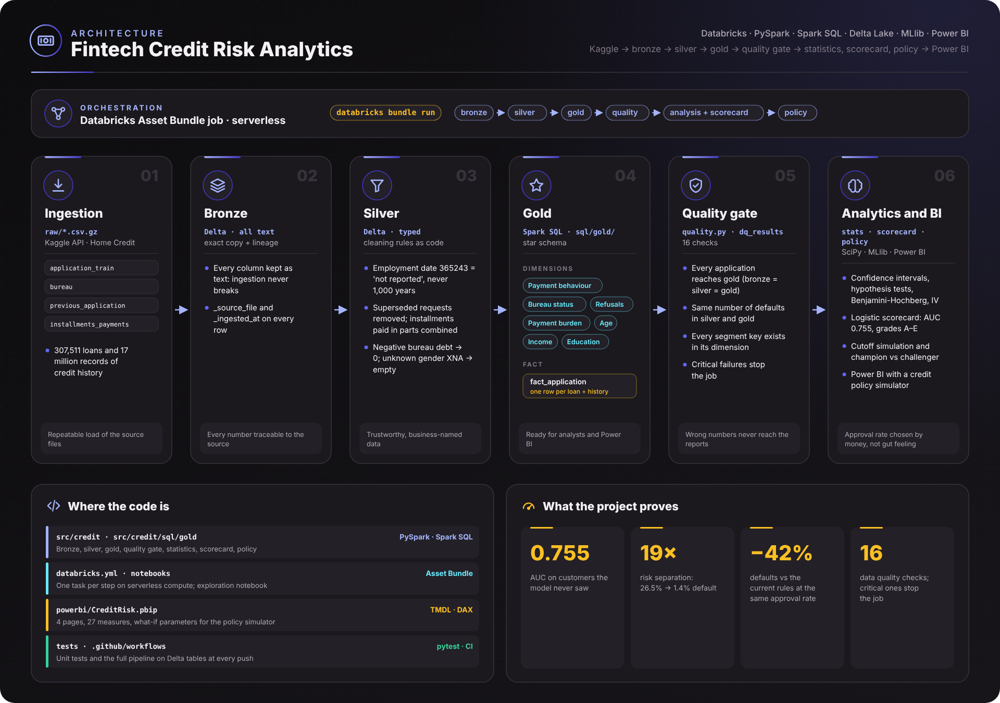
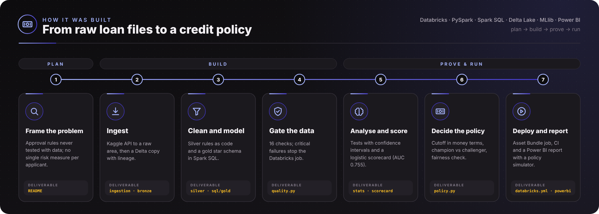
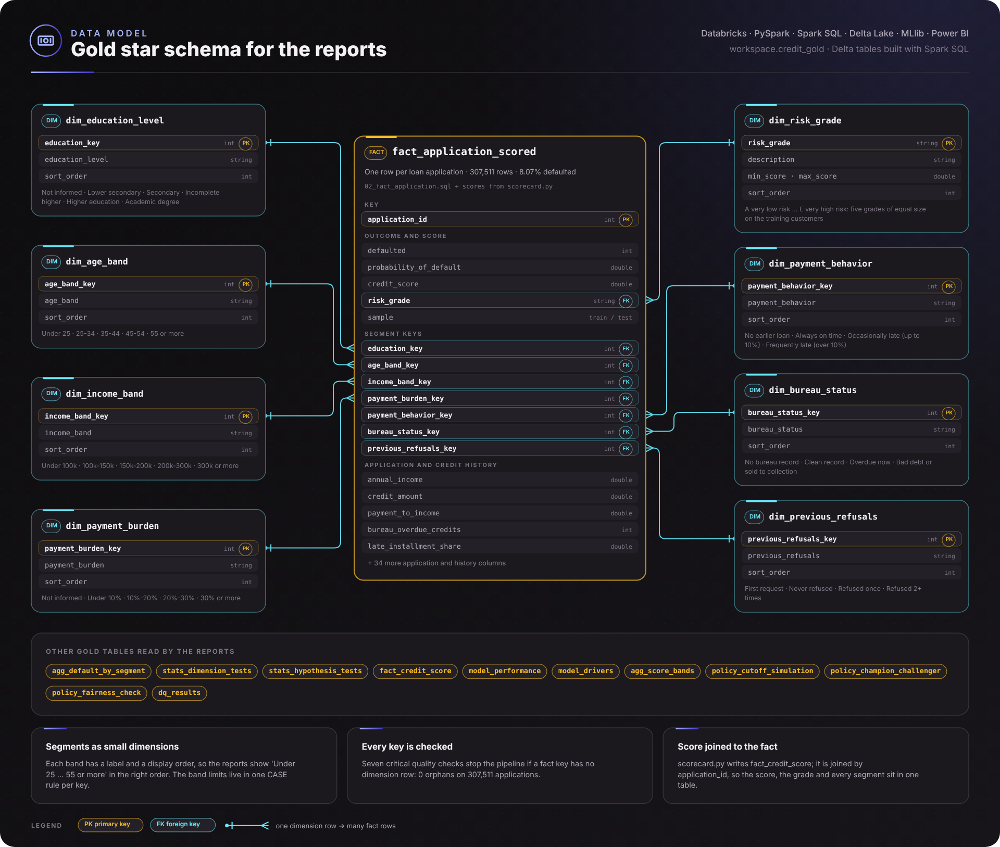

# Fintech Credit Risk Analytics

[](https://github.com/vitorchavernue/fintech-credit-risk-analytics/actions/workflows/ci.yml)

End-to-end **credit risk analytics** for a consumer lending business, built on real data from
**307,511 loans** (Home Credit, Kaggle) and **17 million records** of credit history:

- **Databricks** (PySpark, **Spark SQL**, **Delta Lake**, Unity Catalog) with a **medallion architecture**, deployed as a **Databricks Asset Bundle** job
- **Statistics applied to business questions**: hypothesis tests, confidence intervals, multiple-testing correction, Information Value
- **Credit scorecard** (Spark MLlib logistic regression): AUC **0.755**, Gini **0.51**, KS **0.38** on customers the model never saw
- **Credit policy**: approval cutoff simulation in money terms and a **champion vs challenger** experiment with sample-size design
- **Power BI report** (PBIP, versioned in Git): executive overview, risk by segment, credit score and an interactive **credit policy simulator**
- **Star schema**, **16 data quality checks**, **unit tests** and **CI** running the whole pipeline on every push

---

## 🎯 Business problem

A consumer lender approves hundreds of thousands of loans a year. Every decision trades **growth** (approving more
customers) against **losses** (customers who do not pay back). The credit team had the data, but not the answers:

| Problem | Impact |
|---|---|
| Approval rules are based on experience ("reject anyone refused before", "reject payments above 30% of income"), never tested with data | Good customers rejected for no reason, risky customers approved |
| No single measure of risk per applicant | Every analyst reads the same file differently; decisions are inconsistent |
| No way to answer "if we approve 5% more, how much more do we lose?" | The approval rate is set by gut feeling, not by money |
| Differences between customer groups are reported without checking whether they are real or chance | Policies are changed based on noise |
| Credit history is spread across 4 sources and 17 million rows (credit bureau, earlier requests, installment payments) | Nobody looks at payment behaviour, the strongest signal available |

## 💡 Solution

| Component | What was built | Problem solved |
|---|---|---|
| **Ingestion** | Kaggle API or manual zip → raw area, compressed (`.csv.gz`) | Repeatable load of the source files |
| **Bronze** | Exact copy of the files as Delta tables (all text) + lineage (`_source_file`, `_ingested_at`) | Every number traceable to the source |
| **Silver** | Typed, clean tables: source codes handled (employment date `365243` = "not reported"), duplicated requests removed, installments paid in parts combined | Trustworthy, business-named data |
| **Gold (Spark SQL)** | `customer_history` (bureau, earlier requests, payment behaviour) + `fact_application` + 7 dimensions with display order | Star schema ready for Power BI and analysts |
| **Data quality gate** | 16 checks; critical failures stop the job (no application lost, no default lost, every key matched) | Wrong numbers never reach the reports |
| **Statistics** | Default rate by segment with 95% confidence intervals, two-proportion and chi-square tests, Benjamini-Hochberg correction, Information Value | Decisions based on real differences, not chance |
| **Scorecard** | Spark MLlib logistic regression → probability of default → score (600 = 50:1 odds, +20 points doubles the odds) → grades A–E | One explainable risk measure per applicant |
| **Credit policy** | Cutoff simulation (loss avoided vs margin lost), champion vs challenger experiment, fairness check | Approval rate chosen by money, new policy proven before rollout |
| **Databricks + CI** | Asset Bundle job (one task per step, serverless) and GitHub Actions running the full pipeline on Delta tables | Reproducible deployment and no regressions |

## 📈 Results — insights from the full dataset

Running the pipeline over the **complete dataset** (307,511 loans, 8.07% default rate; 1.7 M bureau records,
1.7 M earlier requests, 13.6 M installment payments):

| Finding | Evidence |
|---|---|
| **A popular approval rule does not hold** | Customers committing **30%+ of their income** to the payment default at **8.2% vs 8.1%** — no significant difference (q = 0.60). The rule rejects good customers for nothing |
| **Payment behaviour is a real signal** | Customers late on more than 10% of earlier installments default at **10.9% vs 6.8%** for those always on time (1.6×); refused 2+ times: **11.7% vs 7.1%** |
| **Problems at other institutions double the risk** | A loan **overdue now** at another lender: **16.2%** default vs **7.6%** with a clean record (2.1×) |
| **"Thin file" customers are riskier** | Customers **unknown to the credit bureau** default at **10.1%** — more than customers with a clean record (7.6%) |
| **The score separates risk 19×** | Default rate goes from **26.5%** in the lowest 10% of scores to **1.4%** in the highest 10%; the lowest 30% hold **65%** of all defaults |
| **The best cutoff approves 90%** | Approving scores ≥ **532** avoids **33% of defaults** and is the most profitable point (assumptions: 45% loss given default, 10% net margin) |
| **The score beats the current rules by 42%** | At the same approval rate (~74%), approved customers default at **4.15% vs 7.13%** with the rule-based policy (−2.98 pp, 95% CI −3.33 to −2.63, p < 1e-16) |
| **A live A/B test would be short** | Only **~1,300 applications per arm** are needed to confirm the gain with 80% power |
| **Fair without using gender** | Gender is not used by the model; at the recommended cutoff the approval ratio between genders is **0.94** (four-fifths rule: ≥ 0.80) |

Full results, generated by the pipeline from the gold tables: [**findings**](docs/findings.md) · [**data quality report**](docs/data_quality.md).







## 📊 Power BI report

Power BI project ([`powerbi/CreditRisk.pbip`](powerbi/)) saved in the **PBIP format**: the semantic model (TMDL) and every
page and visual (JSON) are plain text, reviewed and versioned in Git like the rest of the code.






| Page | What it answers |
|---|---|
| **Executive overview** | Portfolio size, default rate, credit granted, estimated loss, score quality; default rate by risk grade and payment behaviour; business rules tested with data |
| **Risk by segment** | Default rate by payment behaviour, bureau status, earlier refusals and age (95% confidence interval in the tooltip), with income type and contract filters; Information Value of each characteristic |
| **Credit score** | AUC, Gini, KS; default rate by score band; share of defaults found by the score; predicted vs observed (calibration); top 10 factors |
| **Credit policy simulator** | **Sliders** for the minimum score, loss given default and net margin: approval rate, default rate, defaults avoided, good customers rejected and net benefit recalculate instantly; champion vs challenger and fairness check |

Semantic model: star schema (`Credit Applications` + 8 dimensions with display order), **27 DAX measures** with descriptions
(Wilson confidence interval, what-if policy measures), 3 what-if parameters and a custom theme.

Layout: one design system for every page (navy and blue palette, navigation rail, card frames with icons). The page
backgrounds are vector designs in [`powerbi/design/`](powerbi/design/) (SVG, one named frame per card and chart, ready to
edit in Figma) exported as PNG into the report, so each visual sits exactly on its own frame.

To open it: `python scripts/export_powerbi.py --out <folder>` (exports the gold tables as Parquet), set the `DataFolder`
parameter to that folder and refresh. On Databricks, point the same model to the Unity Catalog gold tables.

## 🏗️ Architecture





<sub>Diagrams generated by [`scripts/build_architecture.py`](scripts/build_architecture.py) (SVG and PNG in `docs/images/`).</sub>

## 🔬 Statistical methods (in plain words)

| Method | Question it answers | Where |
|---|---|---|
| **Wilson confidence interval** | Where is the true default rate of this segment, with 95% confidence? (reliable even for small groups) | `agg_default_by_segment` |
| **Two-proportion z-test** | Is the difference between two groups real, or could it be chance? | `stats_hypothesis_tests`, champion vs challenger |
| **Chi-square test + Cramér's V** | Does the default rate change across the segments of a characteristic, and how strongly? | `stats_dimension_tests` |
| **Benjamini-Hochberg** | Testing 50 segments at 5% "finds" ~2 effects by luck; the corrected q-value removes them | all segment tests |
| **Information Value** | The credit market's standard measure of how well a characteristic separates good and bad customers | `stats_dimension_tests` |
| **AUC, Gini, KS** | How well does the score rank customers? Measured on 30% of customers kept aside | `model_performance` |
| **Sample size (power analysis)** | How many applications must a live A/B test have to detect the difference? | `policy_champion_challenger` |

## ⭐ Data model (gold)



<sub>Generated by [`scripts/build_architecture.py`](scripts/build_architecture.py) (SVG and PNG in `docs/images/`).</sub>

Plus result tables for the reports: `agg_default_by_segment`, `stats_hypothesis_tests`, `stats_dimension_tests`,
`model_performance`, `model_drivers`, `agg_score_bands`, `policy_cutoff_simulation`, `policy_champion_challenger`,
`policy_fairness_check` and `dq_results`.

## ✅ Data quality

| Check | Severity |
|---|---|
| Every application of the source file reaches the reports (bronze = silver = gold) | critical |
| Application id unique; outcome always 0 or 1; same number of defaults in silver and gold | critical |
| Loan amount and income positive; external scores between 0 and 1 | critical |
| Every segment key of the fact table exists in its dimension (7 checks) | critical |
| Bureau records linked to an application; employment not reported; installments never paid | info |

Rules applied in silver (each one explained in the code): employment date `365243` means "not reported"
(18% of customers, mostly pensioners) and is never read as 1,000 years of work; unknown gender code `XNA` → empty;
negative bureau debt (credit balance) → 0; superseded versions of earlier requests removed; installments paid in
several parts combined into one installment.

## ▶️ Run it

**Locally** (Spark local mode, synthetic sample — no account needed):

```bash
make setup      # PySpark, Delta Lake, SciPy...
make test       # unit tests: statistics, cleaning rules, scorecard, credit policy
make pipeline   # bronze → silver → gold → quality gate → statistics → scorecard → policy → findings
```

**With the real data** (Kaggle account that accepted the competition rules):

```bash
python ingestion/download_home_credit.py --from-kaggle --target data/raw/home_credit
CREDIT_RAW_DIR=data/raw/home_credit make pipeline
```

**On Databricks** (Free Edition works): `databricks bundle deploy && databricks bundle run credit_risk_pipeline` —
step by step in [docs/databricks.md](docs/databricks.md). The notebook
[`notebooks/credit_risk_exploration.py`](notebooks/credit_risk_exploration.py) answers the business questions with Spark SQL.

## 📁 Project structure

```
├── databricks.yml              # Databricks Asset Bundle: job with one task per step
├── ingestion/                  # Kaggle download → raw area
├── src/credit/
│   ├── bronze.py · silver.py   # copy of the sources · cleaning rules
│   ├── gold.py + sql/gold/     # star schema in Spark SQL (one file per table)
│   ├── quality.py              # data quality gate
│   ├── stats.py · analysis.py  # statistical tests · segment analysis and business hypotheses
│   ├── scorecard.py            # credit score (Spark MLlib)
│   ├── policy.py               # cutoff simulation, champion vs challenger, fairness
│   └── pipeline.py             # runs all steps (locally or as Databricks tasks)
├── notebooks/                  # Databricks exploration notebook (Spark SQL)
├── powerbi/                    # Power BI project (PBIP): semantic model (TMDL) + report pages
├── scripts/                    # synthetic sample generator, README charts
├── sample_data/                # SYNTHETIC sample with the Home Credit layout (used by tests and CI)
├── tests/
└── docs/                       # findings, data quality report, Databricks guide, charts
```

## 📄 Data

[Home Credit Default Risk](https://www.kaggle.com/competitions/home-credit-default-risk) (Kaggle). The competition rules
do not allow redistributing the data, so this repository contains only a **synthetic sample** with the same layout
(generated by `scripts/make_sample_data.py`), used by the tests and the CI. All results above come from the real files.

## 🛠️ Tech stack

**Databricks** · **PySpark** · **Spark SQL** · **Delta Lake** · **Unity Catalog** · **Spark MLlib** · **Python** ·
**SciPy** · **pandas** · **Databricks Asset Bundles** · **GitHub Actions** · **Power BI** (PBIP, TMDL, DAX)
