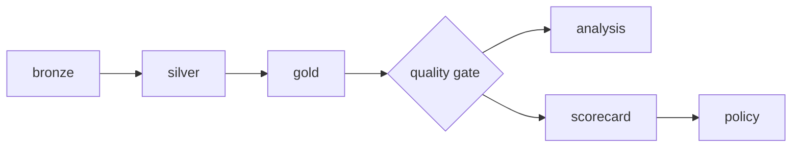

# Running on Databricks (Free Edition or any workspace)

The pipeline is deployed as a **Databricks Asset Bundle** ([`databricks.yml`](../databricks.yml)):
one command packages the code, uploads it and creates the job **credit-risk-pipeline**,
with one task per step running on **serverless** compute.



## 1. Prepare the workspace (once)

In a SQL editor or notebook:

```sql
CREATE SCHEMA IF NOT EXISTS workspace.credit_raw;
CREATE VOLUME IF NOT EXISTS workspace.credit_raw.home_credit;
```

Upload the four files (`.csv` or `.csv.gz`) to the volume — **Catalog → workspace → credit_raw →
home_credit → Upload to this volume** — or with the CLI:

```bash
databricks fs cp data/raw/home_credit/ dbfs:/Volumes/workspace/credit_raw/home_credit/ --recursive
```

## 2. Deploy and run

```bash
# Databricks CLI: https://docs.databricks.com/dev-tools/cli/install.html
databricks auth login --host https://<your-workspace>.cloud.databricks.com
databricks bundle validate
databricks bundle deploy -t dev
databricks bundle run credit_risk_pipeline -t dev
```

The tables are created in Unity Catalog:

| Schema | Tables |
|---|---|
| `workspace.credit_bronze` | copy of the source files |
| `workspace.credit_silver` | clean, typed tables |
| `workspace.credit_gold` | star schema, statistics, scores, credit policy, data quality results |

Another catalog or volume: `databricks bundle deploy -t dev --var="catalog=main" --var="raw_dir=/Volumes/main/credit/raw"`.

## 3. Explore

Import [`notebooks/credit_risk_exploration.py`](../notebooks/credit_risk_exploration.py) into the workspace
(**Workspace → Import**) and run it: each cell answers a business question with Spark SQL.

## Notes for serverless compute

- No `cache()`/`persist()` and no RDD API are used, as serverless only supports Spark Connect APIs.
- Parameters are passed as task arguments (`--catalog`, `--raw-dir`), not environment variables.
- The scorecard uses Spark MLlib logistic regression; the trained model is small (well below the serverless model size limit).
